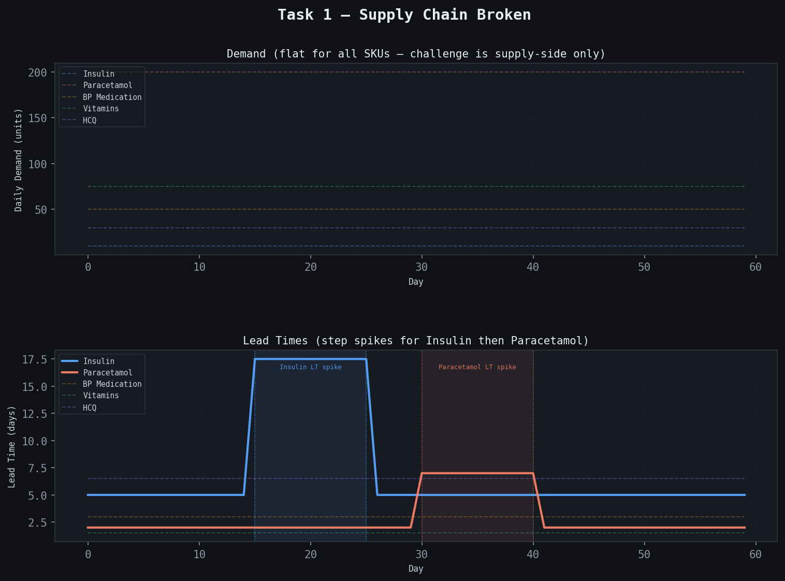
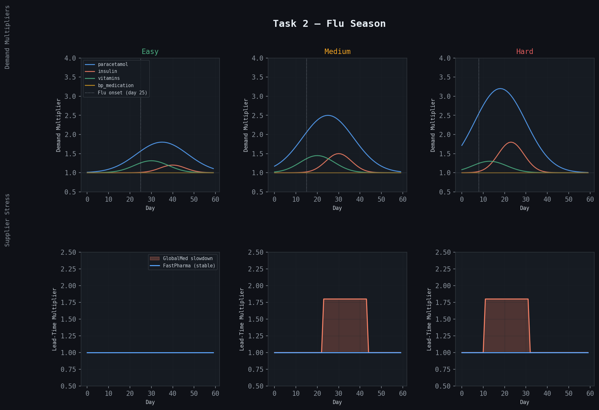
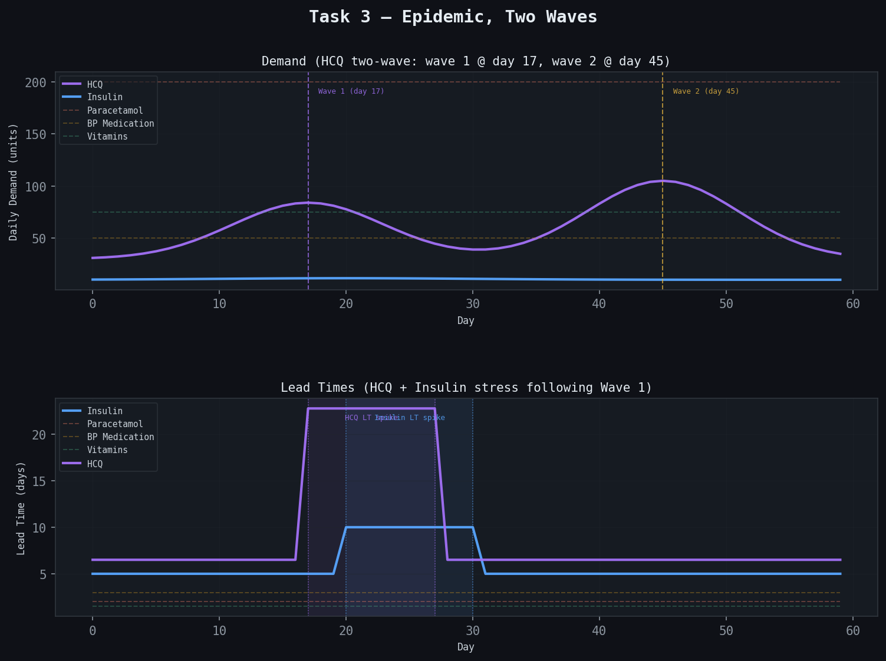

# Pharma Inventory Management — OpenEnv Benchmark

An OpenEnv-compliant benchmark where an LLM agent manages a pharmaceutical warehouse over a 60-day episode. Every day the agent reads an inventory report and decides what to order and how much. Demand is stochastic, lead times are uncertain, and disruptions hit without warning. The agent must act under uncertainty with no visibility into the underlying processes driving the environment.


**The whole story of the project** (purpose, data, evaluation, reward, tools, what went wrong, how it evolved): [`docs/PROJECT_JOURNEY.md`](docs/PROJECT_JOURNEY.md).

---

## The Problem

A warehouse stocks five drugs: insulin, BP medication, paracetamol, vitamins, and hydroxychloroquine. Every day the agent must decide:

- **What to order** — which SKUs need replenishment, and which can wait.
- **How much** — enough to cover demand without wasting capacity on overstock.

The hard parts are:

- You cannot see today's true demand — only recent observed history.
- Lead times are stochastic and can extend without warning during supply disruptions.
- Insulin has no substitute and a 100-point stockout penalty. Vitamins carry a 5-point penalty. The agent must learn this hierarchy.
- Over-ordering wastes storage capacity and is penalised — but under-ordering causes stockouts.

---

## Warehouse

### Storage Pools

| Pool | Capacity | Used for |
|---|:---:|---|
| Cold storage | 21 days of insulin demand (about 170–250 units) | Insulin |
| Ambient storage | 21 days of the other four SKUs' combined demand (about 6,300–8,600 units) | Paracetamol, BP medication, vitamins, HCQ |

Each pool's capacity is 21 times the summed base demand of the SKUs stored in it, so it scales with the demand drawn for each episode. That is about 25% more than the most a perfect-foresight plan ever needs on any task, so good play always fits, while over-ordering overflows and the excess is wasted (see Scoring). `AMBIENT_STORAGE_DAYS` and `COLD_STORAGE_DAYS` in `tasks.py` set the sizes.

### SKUs

Insulin is the cold-chain SKU; the other four use ambient storage.

| SKU | Drug | Stockout Penalty | Waste Penalty | Base Demand | Base Lead Time |
|---|---|:---:|:---:|---|---|
| `insulin` | Insulin | 100 | 10 | 8–12 units/day | 4–6 days |
| `bp_medication` | Amlodipine | 60 | 3 | 40–60 units/day | 2–4 days |
| `paracetamol` | Paracetamol | 20 | 1 | 180–220 units/day | 1–3 days |
| `vitamins` | Vitamins | 5 | 0.5 | 60–90 units/day | 1–2 days |
| `hydroxychloroquine` | Hydroxychloroquine (HCQ) | 35 | 4 | 20–40 units/day | 5–8 days |

Base demand, base lead time and starting inventory (1–5 units, so every episode starts nearly empty) are sampled when the task is built, from the ranges above. Tasks are seeded: the same `seed` always produces the same episode.

Every day is also a little random:

- **Demand:** true daily demand is `base_demand × demand_curve[day]` plus Gaussian noise with a standard deviation of 12% of base demand (`DEMAND_NOISE_CV` in `tasks.py`).
- **Lead times:** each order's lead time is `base_lead_time × lead_time_curve[day]` plus Gaussian noise with a standard deviation of 0.75 days (`LEAD_TIME_NOISE_STD`), rounded to whole days and at least 1.

The environment draws all of this noise once, at `reset`, from the seed. The same seed therefore gives the same demand every day, and the same lead time for an order placed on a given day, **whatever the agent does**. That makes comparisons between agents fair, and lets you replay one situation with different actions, e.g. to score several candidate answers for RL training.

---

## What the Agent Observes

Each step the agent receives a full `InventoryState` rendered as a JSON report. Per-SKU signals:

| Field | Description |
|---|---|
| `inventory_on_hand` | Units on shelf right now |
| `stockout_days_if_no_reorder` | Days until stockout at current demand rate — most urgent signal |
| `avg_demand_per_day` | Rolling average demand over all history |
| `avg_demand_last_5_days` | Short-window average — reacts faster to spikes |
| `avg_lead_time` | Rolling average delivery time from all past orders |
| `lead_time_last3_orders` | Lead times of the last 3 delivered orders — rising values signal supply stress. A lead time only becomes visible once that order arrives |
| `expected_inbound_orders` | Open orders with estimated arrival day |
| `stockout_penalty` | Criticality weight for this SKU |

Global signals:

| Field | Description |
|---|---|
| `cold_storage_ratio` | Cold pool utilisation (0–1) |
| `ambient_storage_ratio` | Ambient pool utilisation (0–1) |
| `inventory_excess_today` | Units of today's deliveries rejected because storage was full |
| `waste_fraction_today` | Share of today's deliveries rejected, weighted by `waste_penalty` (0–1) |
| `inventory_excess_cumulative` | Sum of `1 - waste_fraction_today` so far (+1 per waste-free day) |

---

## Action Format

Each day the agent responds with a JSON object mapping SKU names to order quantities:

```json
{"insulin": 100, "paracetamol": 500}
```

Only include SKUs you want to order. Send `{}` to place no orders today.

The LLM prompt (`inference.py`, also used by `agents.LLMAgent`, `eval.py`, the dashboard and `PharmaEnvironment.to_llm_prompt()`) shows the report one SKU per line and adds two values computed from the observation: `inbound_units` (already ordered, not yet arrived) and `days_of_cover` ((on hand + inbound) ÷ recent daily demand). It shows the results of the last 3 days but not the model's own earlier replies, and its instructions contain no example quantities: small models tend to copy either one instead of reading the report.

**Three action formats for LLM agents** (`action=` in `agents.LLMAgent`, `--action` in `eval.py` and `local_llm/run_local_llm.py`):

| Format | The model answers | Worst case |
|---|---|---|
| `adjust` (default) | extra days per SKU, 0 to +10, added to the baseline's default of lead time + 3 safety days | about the baseline: a copied number, a 0, a missing SKU or a reply without JSON keeps the default |
| `days` | the days of stock it wants per SKU | an empty shelf: an answer of 0 orders nothing |
| `units` | units to order per SKU | anything |

**`adjust`:** the baseline rule does the ordering and the model only decides where to keep extra stock on top of the default, e.g. `{"paracetamol": 4, "vitamins": 0, "insulin": 1}`. The report leaves out `days_of_cover`: Qwen 2.5 3B, answering in `days`, copied it until its stock ran out (scores 0.17-0.44). On 20 test seeds per task, answering 0 for everything scores 0.869 (the baseline), +3 for everything 0.886, +5 for everything 0.893 and +10 for everything (e.g. a copied large number, clipped) 0.882; the oracle reaches 0.932. Negative values are not allowed: keeping less than the default only added stockouts (-1 for everything: 0.853, -3: 0.728).

**`days`:** the model answers with the **days of stock** it wants per SKU, e.g. `{"paracetamol": 8, "insulin": 6}`, and `inference.days_to_units()` turns that into an order using only observed values:

```
units ordered = days x recent daily demand - inventory_on_hand - inbound_units
```

Recent daily demand is the larger of `avg_demand_last_5_days` and `avg_demand_per_day`. Days are capped at 21 (the storage size), and orders under one unit are dropped. The model decides *how much cover* it wants; the arithmetic, which small models get wrong, is done in code. With `--action units` the model writes units itself, using `SYSTEM_PROMPT` (the format `inference.py` and the benchmark use). For example, Gemma 2 2B scored 0.24 in units mode, mostly because it copied the report's small numbers as order sizes.

The environment also accepts a raw LLM message string — it extracts the first valid JSON object from the text automatically. SKU names are matched case-insensitively and numeric strings are accepted; unknown SKUs, non-positive or non-numeric quantities are ignored instead of failing the step.

---

## Tasks

Three scenario types. All episodes run 60 days. Base demand and lead times are randomised at episode start within the ranges in the SKU table.

### Task 1 — Supply Chain Broken (`supply_chain_broken`)

Demand is flat across all SKUs. The challenge is entirely supply-side: lead times extend sharply for two SKUs in sequence, forcing the agent to build safety stock before the disruption hits.

- Insulin lead times step up during days 15–25.
- Paracetamol lead times step up during days 30–40.
- Step amplitudes are randomised at episode start (2×–5× baseline).

The agent that waits for stockout signals will order too late — orders placed after the lead time extends arrive after the stockout.




### Task 2 — Flu Season (`flu_season`)

A flu outbreak drives a Gaussian demand surge for paracetamol, peaking at day 30 with amplitude 2× baseline. All other SKU demands remain flat.

- Paracetamol demand follows a bell curve (peak day 30, width 10).
- Paracetamol lead times also step up during days 30–40 (logistics stress during the peak).
- The agent must pre-stock before day 30 — ordering at peak demand while lead times are stretched leaves no time for delivery.




### Task 3 — Epidemic, Two Waves (`epidemic_two_wave`)

A two-wave epidemic drives hydroxychloroquine (HCQ) demand through two sequential spikes. Insulin sees a mild secondary elevation following the first wave.

- HCQ wave 1: Gaussian peak at day 17 (amplitude 1.8×).
- HCQ wave 2: Gaussian peak at day 45 (amplitude 2.5×) — larger than wave 1.
- Insulin: mild Gaussian elevation peaking ~day 20.
- HCQ lead times step up during days 17–27 (amplitude 2×–5×).
- Insulin lead times step up during days 20–30 (amplitude 1×–3×).

The trough between waves (days 27–40) is a trap: demand is low but the agent must keep ordering because wave 2 is larger and HCQ lead times are long (5–8 day baseline).



### Scenarios: fixed or random

By default (`scenario="fixed"`) every seed disrupts the same SKUs on the same days; only the size of each disruption changes. The **random scenario** (`scenario="random"` in `env.reset` / `get_task_config`, `--random-scenarios` in `eval.py` and `local_llm/run_local_llm.py`) draws per seed which SKUs are disrupted and when, and gives each storage pool **14 days** of demand instead of 21:

| Task | Fixed | Random scenario |
|---|---|---|
| Supply Chain Broken | insulin delay days 15–25; paracetamol delay 30–40 | two different SKUs drawn from all five; the first delay starts on day 10–20 and lasts 9–13 days, the second starts 3–10 days after it ends and lasts 9–13 days |
| Flu Season | paracetamol: demand peak day 30 (2× extra, width 10), delay days 30–40 | one SKU drawn from all five: peak on day 24–38 at 1.5–2.5× extra, width 8–12 (never 1.5× normal before day 8); its delay starts within 3 days of the peak and lasts 11 days |
| Epidemic Two Waves | HCQ waves peak on days 17 and 45; HCQ delay 17–27; insulin bump and delay 20–30 | the two SKUs drawn from all five; wave 1 peaks on day 13–23, wave 2 26–32 days later (by day 52; closer waves merge into one); the delays keep their place relative to wave 1, ±2 days |

The scenario has its own random generator, so base demand, lead times, starting stock, daily noise and the size of each disruption are the same for a seed in both scenarios. News follows the drawn SKUs and days. The report shows `cold_days` / `ambient_days`, how many days of current demand each pool can hold, and the prompts refer to them instead of a fixed 21 days. Result files from the random scenario get `_rs` in their names.

**Why it exists.** In the fixed tasks the right response to the news is almost a fixed timetable: averaging perfect news reading (`news_extra_days` on the exact events) per task, day and SKU over 200 train seeds, and playing that calendar without reading anything, earned 94% of the gain of perfect news reading. Drawing only the days did not help (98%): the shortcut is mainly *which SKU* each task disrupts, and with 21 days of storage stockpiling it is nearly free (+7 days of the usual at-risk SKUs every day earned 80%). Measured on 50 test seeds per task with level-2 news:

| Agent | Fixed | Random scenario |
|---|:---:|:---:|
| Baseline | 0.867 | 0.859 |
| Calendar per task, day and SKU (no reading) | 0.900 | 0.868 |
| +3 days on every SKU (no reading) | 0.886 | 0.869 |
| Perfect news reading | 0.902 | 0.877 |
| Oracle | 0.931 | 0.925 |
| **Perfect news reading minus "+3 days on every SKU"** | +0.017 ± 0.003, but a calendar reproduces it | **+0.008 ± 0.003** |

In the random scenario the calendar earns 50% of perfect news reading's gain instead of 94%, and what reading adds over the best fixed habit cannot be had without reading. That margin is small: the perfect news reading rule closes only 27% of the gap to the oracle here (it ignores storage, and on flu_season it adds nothing over the habit), so a better reading rule, or reinforcement learning on the environment's reward, has more to gain than imitating it. Of the storage sizes tried (21, 17, 14 days), 14 gave reading the largest margin over the best habit.

---

## Scoring

### Per-Step Reward

At each step the reward is:

```
step_reward = weighted_fill_today − waste_fraction_today

weighted_fill_today = Σ stockout_penalty_i × demand_fulfilled_today_i / Σ stockout_penalty_i
```

- `demand_fulfilled_today` per SKU is the fraction of true demand served (0.0 = full stockout, 1.0 = fully served).
- The fill rates are averaged with each SKU's `stockout_penalty` as the weight, so a shortage costs in proportion to how critical the medicine is. With the built-in catalogue (insulin 100, BP medication 60, HCQ 35, paracetamol 20, vitamins 5; total 220), a full day without insulin costs 100/220 = 0.45 of the day's reward, and a full day without vitamins 5/220 = 0.02. This matches the prompt's instruction to protect high-`stockout_penalty` SKUs first. (Before, all SKUs counted equally: an insulin stockout cost the same as a vitamins one.)
- `waste_fraction_today` is the share of the day's deliveries rejected because their storage pool was full. It is computed per SKU that received a delivery, then averaged using each SKU's `waste_penalty` as the weight:

  ```
  waste_fraction_today = Σ waste_penalty_i × (wasted_i / delivered_i) / Σ waste_penalty_i
  ```

  It is 0 when nothing arrived, and 1 when every delivery was rejected, so the step reward lies in [-1, 1]. Wasting 1 unit of a 3,000-unit delivery costs almost nothing; wasting half of an insulin delivery costs far more than wasting half of a vitamins delivery.

### Final Episode Score

```
final_score = clip( sum of step rewards / no_of_days , 0, 1 )
            = clip( mean over days of (weighted fill today − waste_fraction_today) , 0, 1 )
```

- The episode score is simply the **average daily step reward**, so an agent is evaluated on exactly what it is rewarded for each day (useful when training with RL).
- An agent that orders nothing serves almost no demand and scores about 0. Waste only ever subtracts, so a day without deliveries earns nothing extra.
- Days not played (an episode cut short) count as 0.
- `tasks.compute_final_score` rebuilds the sum from running totals in the state: `demand_fulfilled_cumulative` per SKU, and `inventory_excess_cumulative`, which adds `1 − waste_fraction_today` each day.

---

## Baselines

Mean final score on the first 50 test seeds per task (`python eval.py --agent <agent> --split test --episodes 50`), with the 95% confidence interval of the mean:

| Agent | Supply Chain | Flu Season | Epidemic Two Waves |
|---|:---:|:---:|:---:|
| Order nothing (floor) | 0.003 | 0.003 | 0.003 |
| Baseline (order-up-to rule) | 0.846 ± 0.008 | 0.900 ± 0.004 | 0.856 ± 0.009 |
| Oracle (perfect foresight, ceiling) | 0.931 ± 0.002 | 0.931 ± 0.002 | 0.932 ± 0.002 |

The oracle is not 1.0 because episodes start with almost no stock: the first days are lost for every agent until a first delivery can arrive. Results for small LLMs are in [LLM results](#llm-results).

## News: disruptions announced ahead of time

The baseline reaches about 93% of the oracle because the observation holds only clean numbers, and turning numbers into orders is solved arithmetic. With **news**, the agent also reads text announcing each disruption a few days before it starts. That is information the baseline cannot use, and reading it is something a language model can do.

`news.py` reads each task's own demand and lead-time curves, turns every disruption into an event (a supplier delay where lead times rise, a demand surge where demand reaches 1.5× normal or more), and publishes it **5–10 days before it starts** (drawn per event from the seed, never before day 0). The world itself is unchanged: news never alters demand, lead times or noise, and the baseline scores exactly the same with or without it.

| Level | What the agent reads | Example |
|---|---|---|
| `0` | No news (the original environment, the default) | — |
| `1` | One fixed template with exact days and multiplier | *SUPPLIER DELAY - insulin: orders placed from day 15 to day 25 will take about 3.7x the normal lead time.* |
| `2` | Varied wording; timing relative to publication and approximate (±1–2 days); severity in words or a rounded number; generic product names (*blood-pressure medication* for `bp_medication`) | *Logistics warning: because of a strike at the cold-chain carrier, deliveries of insulin will be severely delayed, starting in about 5 days, for about 10 days.* |

The observation's `news` list holds every item already published whose event has not ended, each prefixed with its publication day (`"Day 9: ..."`). It also appears in the LLM report when not empty. Use it with `eval.py --news 1` or `--news 2`, or `env.reset(task_name=..., seed=..., news=2)`; add `--random-scenarios` (`scenario="random"`) to draw the disrupted SKUs and days per seed (see [Scenarios](#scenarios-fixed-or-random)). False alarms and irrelevant news are planned for a later level.

**Hybrid agent (`llm_news`).** The baseline does the arithmetic, and the LLM only reads the news and answers with **extra safety days per SKU** (`inference.NEWS_SYSTEM_PROMPT`), e.g. `{"insulin": 6, "paracetamol": 0, ...}`. The extra days are clipped to 0–15 and so that total cover stays within 18 days (storage holds about 21). On days without news the model is not called, so the agent plays exactly like the baseline. A confused model can therefore cost little, and any gain from the news lifts the score *above* the baseline.

**Reference: perfect news reading (`baseline_news`).** This agent reads the exact event behind each published item (not the text) and adds extra days by a fixed rule. Like the oracle, it is a reference: it shows what the news is worth, and it is a natural teacher for fine-tuning. On the first 50 test seeds per task:

| Agent | Supply Chain | Flu Season | Epidemic Two Waves | Gap to oracle closed |
|---|:---:|:---:|:---:|:---:|
| Baseline (ignores news) | 0.846 ± 0.008 | 0.900 ± 0.004 | 0.856 ± 0.009 | — |
| `baseline_news`, news level 1 | 0.898 ± 0.005 | 0.904 ± 0.004 | 0.907 ± 0.004 | 56% |
| Oracle | 0.931 ± 0.002 | 0.931 ± 0.002 | 0.932 ± 0.002 | 100% |

Level 2 gives nearly the same scores (0.903 overall, 55% of the gap), since the rule reads the events, not the text. The open question for an LLM is how much of that +0.036 it recovers from the text alone, especially at level 2.

## LLM results

Small models run locally with Ollama (`local_llm/run_local_llm.py`, temperature 0.2) on test seeds. Every run below is scored under the **current** reward (fill weighted by `stockout_penalty`): each episode saved the exact order sent every day, and since a seed fixes the world, replaying those orders in the current environment reproduces the run exactly (the same fill rate for every SKU on every day) and gives its score under today's reward. The reference agents are scored on the same seeds. The prompts also changed between runs (each run used the prompt of its answer format at the time); rescoring changes only the reward, not what the model saw.

| Model | Answer format | News | Episodes | Score | Baseline | +2 days for every SKU | Oracle |
|---|---|---|---|:---:|:---:|:---:|:---:|
| Qwen 2.5 1.5B | `units` | — | flu_season, seed 10000 | 0.000 | 0.895 | 0.900 | 0.923 |
| Gemma 2 2B | `units` | — | flu_season, seed 10000 | 0.420 | 0.895 | 0.900 | 0.923 |
| Gemma 2 2B | `days` | — | 3 tasks × seed 10000 | 0.747 | 0.875 | 0.893 | 0.936 |
| Qwen 2.5 3B | `days` | — | 3 tasks × seed 10000 | 0.521 | 0.875 | 0.893 | 0.936 |
| Phi-4-mini (3.8B) | `adjust` | — | 3 tasks × seed 10000 | 0.886 | 0.875 | 0.893 | 0.936 |
| **Phi-4-mini (3.8B)** | **`adjust`** | **level 2** | **3 tasks × seeds 10000–10002** | **0.881** | **0.874** | **0.884** | **0.935** |

"+2 days for every SKU" is a fixed answer in the `adjust` format that never reads the report: a reference for "keep a little more stock". For the news run, perfect news reading (the `news_extra_days` rule on the exact events, answered in the `adjust` format) scores 0.900 on the same 9 episodes.

What each run showed:

- **`units` (Qwen 1.5B, Gemma 2B):** the models copied numbers instead of computing orders. Qwen 1.5B answered `{"insulin": 100}` every day, copying the prompt's example: nothing else was ever ordered, and 100 insulin a day overflowed cold storage on 35 of 60 days, so the waste penalty cancelled what insulin earned (score clipped to 0). Gemma 2B copied the report's `inventory_on_hand` values as order sizes (3-6 units of paracetamol a day against a demand of several hundred). Its 0.420 comes almost entirely from insulin and HCQ, the two SKUs it kept mostly in stock (86% and 73% filled), which carry 45% and 16% of the reward weight; paracetamol was 1% filled.
- **`days` (Gemma 2B, Qwen 3B):** the code does the arithmetic, which removed the copying of report values as quantities, but the models copied `days_of_cover` (what they already had) as their target. Stock ran down until nothing was reordered; Gemma then jumped to 30 days at a time and overflowed storage (17,000-81,000 units wasted per episode), and Qwen let its targets fall to 0: it kept insulin about 89% filled while the other SKUs mostly ran out (189-247 stockout SKU-days per episode; on epidemic_two_wave it ordered nothing but insulin from day 1).
- **`adjust` without news (Phi-4-mini):** valid JSON every day and no collapse, +0.011 over the baseline, but below the fixed "+2 days for every SKU" (0.893): its gain is "keep a little more stock", not reading the report.
- **`adjust` with level-2 news (Phi-4-mini, 9 episodes):** +0.007 ± 0.016 over the baseline (95% CI, not significant), 11% of the gap to the oracle (perfect news reading: 43%). It picks the right SKU and roughly the right timing (insulin from the day a cold-chain strike is announced until it ends), but the amounts are off: +5 where about +14 is needed for an insulin delay, and +10 to +19 days of paracetamol after the flu peak, which wasted 6,700-13,000 units per flu_season episode and made that task worse than the baseline (-0.020). It also adds days with no news (insulin and HCQ on days 1-8) and alternates between +7 and nothing on consecutive days with the same news.

**So far:** the `adjust` format made small models safe (no run in it falls far below the baseline), but none has yet shown a reliable gain from reasoning: every LLM result is at or below a fixed "+2 days for every SKU". These are few episodes; compare runs seed by seed with `eval.py --compare`, and use more seeds (`--episodes 5`) before drawing conclusions.

## Evaluating an agent

`eval.py` plays an agent over many seeded episodes and reports the mean score per task. It runs the environment in-process (no server needed), and rule-based agents run in parallel.

```bash
uv run python eval.py --agent baseline --split test --episodes 50   # -> results/baseline_test_50.jsonl
uv run python eval.py --agent oracle   --split test --episodes 50

# Any OpenAI-compatible model, e.g. a local Ollama server (no API limits):
uv run python eval.py --agent llm --model qwen2.5:3b --base-url http://localhost:11434/v1 \
                      --split test --episodes 10 --save-steps
```

LLM agents answer in adjustment days by default; `--action days` or `--action units` selects the other formats (see the LLM prompt notes above). With `--save-steps`, each step stores the model's own reply (`reply`) and the units actually sent (`orders_sent`).

**Running a model on your own computer:** see [`local_llm/README.md`](local_llm/README.md). One command, e.g. `uv run python local_llm/run_local_llm.py --model qwen2.5:3b`, sets up the model with Ollama the first time and runs it against the baseline and oracle on the same seeds.

**Agents** (`agents.py`): `nothing` (the floor), `baseline` (an order-up-to rule), `oracle` (reads the episode's hidden demand and lead times and plans just-in-time deliveries; the ceiling, never something to train against), `llm` (the same prompt as `inference.py`), and, for news (`--news 1` or `2`), `baseline_news` (perfect news reading, a reference) and `llm_news` (the hybrid: the LLM reads the news, the baseline orders).

```bash
uv run python eval.py --agent baseline_news --news 2 --split test --episodes 50
uv run python eval.py --agent llm_news --news 2 --model qwen2.5:3b --base-url http://localhost:11434/v1 \
                      --split test --episodes 10 --save-steps
```

**Seeds:** `--split train` uses seeds 0–9,999 and `--split test` uses 10,000–19,999, always the first `--episodes` of them. Tune prompts and train models on train seeds only, and report test seeds.

**Output:** one JSON line per episode, with its score, average fill rate, stockout SKU-days, overflow days, units wasted and, for LLMs, how many replies contained no JSON and how many calls failed. `--save-steps` also stores every day's reply and reward.

**Comparing agents:** the same seed gives the same world to every agent, so compare seed by seed:

```bash
uv run python eval.py --compare results/llm_qwen2.5-3b_test_10.jsonl results/baseline_test_50.jsonl \
                      --oracle results/oracle_test_50.jsonl
```

This prints the mean per-seed difference with its 95% confidence interval and, with `--oracle`, the **gap closed**: 0% means as good as the baseline, 100% means as good as perfect foresight. Per-seed differences cancel out each seed's luck; comparing a variant of the baseline against the baseline this way gave a confidence interval about 4× tighter than comparing the two averages.

---

## Training reward (GRPO)

`training/grpo_reward.py` scores answers in the `adjust` format for GRPO training, using the simulator only (no model calls). One prompt is one day with visible news in the random scenario (level-2 news, train seeds), rebuilt by letting the baseline play the earlier days. An answer's reward is how much better than answering 0 it does over the next 15 days (the answer sets today's order, then the baseline orders), averaged over 4 possible futures that every answer to the same prompt shares, in points (hundredths of a day's reward, per day), with small penalties for an answer without JSON (-1) or with values outside 0..10 (-0.25). The rules and the measurements behind each one are in [`training/REWARD.md`](training/REWARD.md). Scoring a group of 8 answers takes about 0.1 s.

## Training Phi-4-mini with GRPO (Kaggle)

`training/grpo_phi4mini_kaggle.ipynb` is the full run, in clearly separated cells:

1. setup;
2. Phi-4-mini in 4-bit with LoRA (Unsloth);
3. training prompts (news days, train seeds 0–8999) and a probe exam on held-out seeds 9000–9099;
4. the untrained model on test seeds;
5. GRPO with health metrics and a probe exam every 25 steps;
6. saving the LoRA adapter;
7. after-training evaluation: test-seed probe, full 60-day episodes against the baseline, "+3 everywhere", perfect news reading and the oracle with paired 95% intervals, plus news-0 and fixed-scenario checks;
8. a verdict, a GGUF export for Ollama, and a results zip.

**To run it on Kaggle:**
1. Create a new notebook and import this `.ipynb` (File → Import Notebook).
2. Turn on **GPU T4 ×2** and Internet.
3. Choose *Save Version → Save & Run All*.

With two GPUs, training runs on GPU 0, and all evaluation runs on GPU 1 in a background process (`training/eval_worker.py`):
- the untrained model's probe exams and episodes;
- a probe exam on every checkpoint;
- half of the after-training episodes.

On one GPU, everything runs in the notebook. Training stops early by itself if the evaluation after it would not fit in Kaggle's 12 h (`SESSION_HOURS`).

The notebook's GPU-free helpers are tested in `tests/test_training_helpers.py`:
- `training/probe.py`: the probe exam;
- `training/episodes.py`: batched full episodes with a local model;
- `training/monitor.py`: the training-health numbers;
- `training/eval_worker.py`: the GPU 1 evaluation worker (tested in `tests/test_eval_worker.py`).

## Setup

```bash
# Install dependencies
uv sync

# Start the environment server
uv run uvicorn server.app:app --host 0.0.0.0 --port 8000 --reload

# Run the benchmark (separate terminal)
uv run python inference.py
```

### Web Playground

The Docker image sets `ENABLE_WEB_INTERFACE=true`, so the server also serves OpenEnv's Gradio Playground at `/web` (`/` redirects there). On the Hugging Face Space it is the page that opens.

- **Reset** starts a new episode, then **Step** advances one day.
- Type orders in either box: **Orders** takes a JSON object such as `{"insulin": 40}`, and **Message** takes free text containing one, as an LLM would reply.
- The raw JSON shows the full `InventoryState`, including ground-truth fields such as `actual_inbound_orders` that the agent's prompt in `inference.py` leaves out.
- The Reset button takes no parameters, so it loads the small 30-day, two-SKU default episode. To play one of the three tasks, reset through the API and keep using the page:

```bash
curl -X POST http://localhost:8000/web/reset \
     -H 'Content-Type: application/json' \
     -d '{"task_name": "flu_season", "seed": 42}'
```

To run it locally:

```bash
ENABLE_WEB_INTERFACE=true uv run uvicorn server.app:app --port 8000
# open http://localhost:8000/web
```

### Live dashboard (Custom tab)

Next to the Playground, `/web` has a **Custom** tab that plays a whole episode and redraws charts after every simulated day:

- **Pick** a task, a seed and an agent, then press **Run episode** (**Stop** cancels).
- **Agents:**
  - *Baseline*: a simple order-up-to rule. It needs no API key and finishes in seconds.
  - *LLM agent*: uses the same prompt and action history as `inference.py`, one model call per day, so a 60-day episode makes 60 calls and takes about 1–5 minutes.
- **Charts:** stock on hand vs. demand, true lead time vs. the agent's estimate, orders and deliveries, step reward, and unmet demand for every SKU and day. **Orange lines are hidden ground truth the agent never sees**, so you can judge its decisions.
- **Tables:** every agent decision (the model's raw reply and the orders accepted), plus a per-day data table for the selected SKU.

To use the LLM agent on the Hugging Face Space, add your token as a **Secret** named `HF_TOKEN` (Space → Settings → Variables and secrets), or paste a token under *LLM settings* for a single run. Calls go through [Inference Providers](https://huggingface.co/docs/inference-providers) and count against that account's credits. `MODEL_NAME` sets the default model and `API_BASE_URL` points it at any OpenAI-compatible endpoint. Each run uses its own environment, and runs are queued one at a time.

### Choosing a task on reset

`reset()` accepts either a registered task name or a full config:

```python
await env.reset(task_name="flu_season", seed=42)
await env.reset(episode_config=get_task_config("flu_season", seed=42).model_dump(mode="json"))
```

With neither, a small 30-day two-SKU default episode is used.

### Tests

```bash
uv pip install pytest
uv run python -m pytest tests      # unit tests for the simulation
uv run python smoke_test.py        # direct environment walkthrough
uv run python smoke_test.py --http # also exercises the client (server must be running)
```

### Environment Variables

| Variable | Default | Description |
|---|---|---|
| `API_BASE_URL` | `https://router.huggingface.co/v1` | LLM API endpoint |
| `MODEL_NAME` | `Qwen/Qwen2.5-72B-Instruct` | Model identifier |
| `HF_TOKEN` | — | HuggingFace API key |
| `ENV_BASE_URL` | `http://localhost:8000` | Server URL |
| `LOCAL_IMAGE_NAME` | — | Run the server from this Docker image instead of `ENV_BASE_URL` |
| `TASK_SEED` | `42` | Seed for task generation and environment noise |

---

## Project Structure

```
pharma_coldstorage_env/
├── models.py          # Pydantic schemas: SKUState, InventoryState,
│                      # PharmaAction, EpisodeConfig, SKUEpisodeConfig
├── tasks.py           # Task constructors (demand/lead-time curves)
│                      # + compute_step_reward, compute_final_score
├── inference.py       # Benchmark runner — loops over TASK_REGISTRY
├── agents.py          # Agents: nothing, baseline, oracle, LLM
├── eval.py            # Evaluate an agent over many seeds; compare agents
├── local_llm/         # Run a local model with Ollama (one script)
├── client.py          # OpenEnv async HTTP client (PharmaEnvClient)
├── smoke_test.py      # Direct environment test (no server required)
├── tests/             # pytest unit tests
├── openenv.yaml       # Environment manifest
└── server/
    ├── app.py                 # FastAPI application
    ├── dashboard.py           # Live dashboard tab at /web (charts + agents)
    └── my_env_environment.py  # Core simulation: demand sampling,
                               # arrivals, overflow, insights, LLM prompt
```