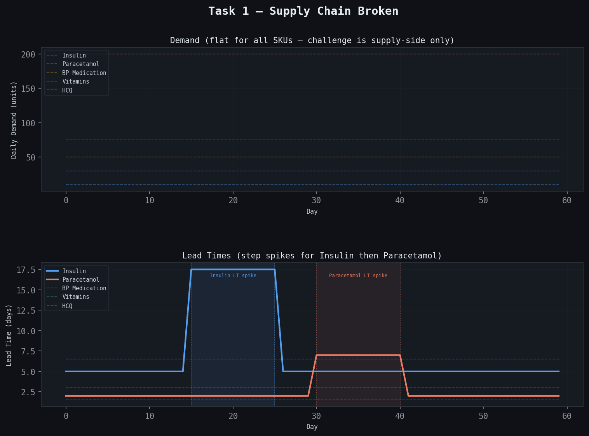
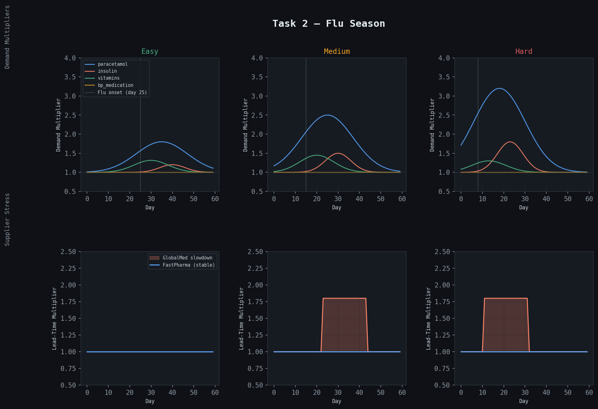
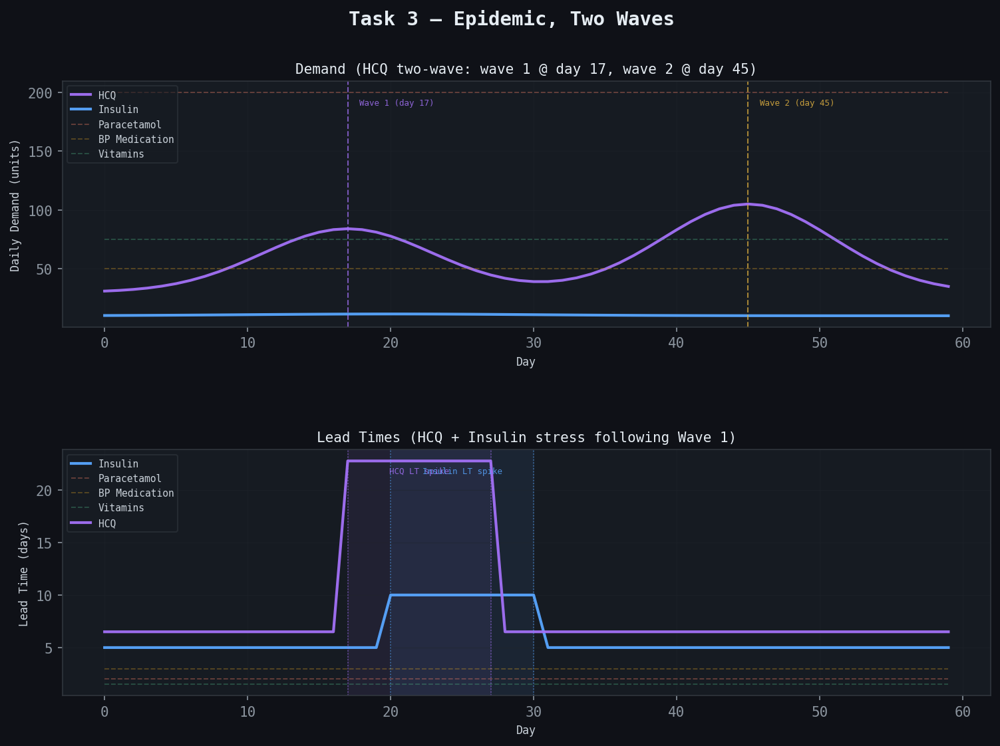

# The pharma world

The built-in world (`worlds/pharma.yaml`): a pharmaceutical warehouse with five drugs, two storage pools and three tasks. It is the world the published results and the trained models use.

## The problem

A warehouse stocks five drugs: insulin, BP medication, paracetamol, vitamins, and hydroxychloroquine. Every day the agent must decide:

- **What to order** — which SKUs need replenishment, and which can wait.
- **How much** — enough to cover demand without wasting capacity on overstock.

The hard parts are:

- You cannot see today's true demand — only recent observed history.
- Lead times are stochastic and can extend without warning during supply disruptions.
- Insulin has no substitute and a 100-point stockout penalty. Vitamins carry a 5-point penalty. The agent must learn this hierarchy.
- Over-ordering wastes storage capacity and is penalised — but under-ordering causes stockouts.

## Warehouse

### Storage Pools

| Pool | Capacity | Used for |
|---|:---:|---|
| Cold storage | 21 days of insulin demand (about 170–250 units) | Insulin |
| Ambient storage | 21 days of the other four SKUs' combined demand (about 6,300–8,600 units) | Paracetamol, BP medication, vitamins, HCQ |

Each pool's capacity is 21 times the summed base demand of the SKUs stored in it, so it scales with the demand drawn for each episode. That is about 25% more than the most a perfect-foresight plan ever needs on any task, so good play always fits, while over-ordering overflows and the excess is wasted (see [Scoring](scoring.md)). The sizes are set in [`worlds/pharma.yaml`](../worlds/pharma.yaml) (`capacity_days`).

These are the pharma world's two pools; a world file can declare any number, with any names (see [World files](world-files.md)). The observation lists every pool in `storage` (`total_capacity`, `current_capacity`, `cold_chain`), and each SKU names its pool in `storage_pool`. The `cold_storage_*` and `ambient_storage_*` fields are the totals over cold-chain pools and over the other pools, which for pharma are exactly the two pools.

### SKUs

Insulin is the cold-chain SKU; the other four use ambient storage.

| SKU | Drug | Stockout Penalty | Waste Penalty | Base Demand | Base Lead Time |
|---|---|:---:|:---:|---|---|
| `insulin` | Insulin | 100 | 10 | 8–12 units/day | 4–6 days |
| `bp_medication` | Amlodipine | 60 | 3 | 40–60 units/day | 2–4 days |
| `paracetamol` | Paracetamol | 20 | 1 | 180–220 units/day | 1–3 days |
| `vitamins` | Vitamins | 5 | 0.5 | 60–90 units/day | 1–2 days |
| `hydroxychloroquine` | Hydroxychloroquine (HCQ) | 35 | 4 | 20–40 units/day | 5–8 days |

Base demand, base lead time and starting inventory (1–5 units, so every episode starts nearly empty) are sampled when the task is built, from the ranges above. Tasks are seeded: the same `seed` always produces the same episode.

Every day is also a little random:

- **Demand:** true daily demand is `base_demand × demand_curve[day]` plus Gaussian noise with a standard deviation of 12% of base demand (`DEMAND_NOISE_CV` in `tasks.py`).
- **Lead times:** each order's lead time is `base_lead_time × lead_time_curve[day]` plus Gaussian noise with a standard deviation of 0.75 days (`LEAD_TIME_NOISE_STD`), rounded to whole days and at least 1.

The environment draws all of this noise once, at `reset`, from the seed. The same seed therefore gives the same demand every day, and the same lead time for an order placed on a given day, **whatever the agent does**. That makes comparisons between agents fair, and lets you replay one situation with different actions, e.g. to score several candidate answers for RL training.

## Tasks

Three scenario types. All episodes run 60 days. Base demand and lead times are randomised at episode start within the ranges in the SKU table.

### Task 1 — Supply Chain Broken (`supply_chain_broken`)

Demand is flat across all SKUs. The challenge is entirely supply-side: lead times extend sharply for two SKUs in sequence, forcing the agent to build safety stock before the disruption hits.

- Insulin lead times step up during days 15–25.
- Paracetamol lead times step up during days 30–40.
- Step amplitudes are randomised at episode start (2×–5× baseline).

The agent that waits for stockout signals will order too late — orders placed after the lead time extends arrive after the stockout.

### Task 2 — Flu Season (`flu_season`)

A flu outbreak drives a Gaussian demand surge for paracetamol, peaking at day 30 with amplitude 2× baseline. All other SKU demands remain flat.

- Paracetamol demand follows a bell curve (peak day 30, width 10).
- Paracetamol lead times also step up during days 30–40 (logistics stress during the peak).
- The agent must pre-stock before day 30 — ordering at peak demand while lead times are stretched leaves no time for delivery.

### Task 3 — Epidemic, Two Waves (`epidemic_two_wave`)

A two-wave epidemic drives hydroxychloroquine (HCQ) demand through two sequential spikes. Insulin sees a mild secondary elevation following the first wave.

- HCQ wave 1: Gaussian peak at day 17 (amplitude 1.8×).
- HCQ wave 2: Gaussian peak at day 45 (amplitude 2.5×) — larger than wave 1.
- Insulin: mild Gaussian elevation peaking ~day 20.
- HCQ lead times step up during days 17–27 (amplitude 2×–5×).
- Insulin lead times step up during days 20–30 (amplitude 1×–3×).

The trough between waves (days 27–40) is a trap: demand is low but the agent must keep ordering because wave 2 is larger and HCQ lead times are long (5–8 day baseline).

### Scenarios: fixed or random

By default (`scenario="fixed"`) every seed disrupts the same SKUs on the same days; only the size of each disruption changes. The **random scenario** (`scenario="random"` in `env.reset` / `get_task_config`, `--random-scenarios` in `eval.py` and `local_llm/run_local_llm.py`) draws per seed which SKUs are disrupted and when, and gives each storage pool **14 days** of demand instead of 21:

| Task | Fixed | Random scenario |
|---|---|---|
| Supply Chain Broken | insulin delay days 15–25; paracetamol delay 30–40 | two different SKUs drawn from all five; the first delay starts on day 10–20 and lasts 9–13 days, the second starts 3–10 days after it ends and lasts 9–13 days |
| Flu Season | paracetamol: demand peak day 30 (2× extra, width 10), delay days 30–40 | one SKU drawn from all five: peak on day 24–38 at 1.5–2.5× extra, width 8–12 (never 1.5× normal before day 8); its delay starts within 3 days of the peak and lasts 11 days |
| Epidemic Two Waves | HCQ waves peak on days 17 and 45; HCQ delay 17–27; insulin bump and delay 20–30 | the two SKUs drawn from all five; wave 1 peaks on day 13–23, wave 2 26–32 days later (by day 52; closer waves merge into one); the delays keep their place relative to wave 1, ±2 days |

The scenario has its own random generator, so base demand, lead times, starting stock, daily noise and the size of each disruption are the same for a seed in both scenarios. News follows the drawn SKUs and days. The report shows `cold_days` / `ambient_days`, how many days of current demand each pool can hold, and the prompts refer to them instead of a fixed 21 days. Result files from the random scenario get `_rs` in their names.

**Why it exists.** In the fixed tasks the right response to the news is almost a fixed timetable: averaging perfect news reading (`news_extra_days` on the exact events) per task, day and SKU over 200 train seeds, and playing that calendar without reading anything, earned 94% of the gain of perfect news reading. Drawing only the days did not help (98%): the shortcut is mainly *which SKU* each task disrupts, and with 21 days of storage stockpiling it is nearly free (+7 days of the usual at-risk SKUs every day earned 80%). Measured on 50 test seeds per task with level-2 news:

| Agent | Fixed | Random scenario |
|---|:---:|:---:|
| Baseline | 0.867 | 0.859 |
| Calendar per task, day and SKU (no reading) | 0.900 | 0.868 |
| +3 days on every SKU (no reading) | 0.886 | 0.869 |
| Perfect news reading, extra-days rule (`baseline_news`) | 0.902 | 0.877 |
| Perfect news reading, inventory plan (`news_plan`) | 0.909 | 0.892 |
| Oracle | 0.931 | 0.925 |
| **Extra-days rule minus "+3 days on every SKU"** | +0.017 ± 0.003, but a calendar reproduces it | **+0.008 ± 0.003** |
| **Inventory plan minus "+3 days on every SKU"** | +0.023 ± 0.004 | **+0.023 ± 0.004** |

In the random scenario the calendar earns 50% of the extra-days rule's gain instead of 94%, and what reading adds over the best fixed habit cannot be had without reading. With the extra-days rule that margin is small: it closes only 27% of the gap to the oracle here (it ignores storage, and on flu_season it adds nothing over the habit). The weakness is the rule, not the news: the inventory plan (`news_plan`, see [News](results.md#news-disruptions-announced-ahead-of-time)) reads the same published events and closes 50% of the gap, three times the margin over the best habit (+0.023 against +0.008), while wasting far fewer units (311 per episode against 1,763). It is the reference to aim for, and the better teacher. Of the storage sizes tried (21, 17, 14 days), 14 gave reading the largest margin over the best habit.
